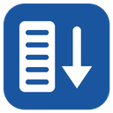

  
  <h1>Side Panel Shot</h1>
  
Webページ内のサイドパネルやモーダルなどのスクロール領域を、見えていない部分も含めて <strong>1枚の縦長 PNG 画像</strong> として保存＆クリップボードにコピーする Chrome 拡張機能

---

## 主な特徴

- **個別スクロール領域の自動結合**: ページ全体ではなく、サイドパネル・ドロワー・モーダル・チャット欄などの内部スクロール領域だけを自動スクロールしながら連続撮影し、1枚の画像に繋ぎ合わせます。
- **固定ヘッダー／Sticky 要素の重複防止**: パネル上部の固定ヘッダーや `position: sticky` 要素を自動検出し、画像の途中に何度も写り込まないよう綺麗に切り抜きます。
- **保存と同時にクリップボードへコピー**: 撮影完了と同時に PNG ファイルをダウンロードし、そのままチャットやドキュメントに `Cmd + V` / `Ctrl + V` で貼り付けられます。
- **最小権限・外部通信なし**: 必要な権限は `activeTab` / `scripting` / `clipboardWrite` のみ。画像処理はすべてブラウザ内で完結します。

---

## インストール方法

1. このリポジトリの **[Releases](../../releases/latest)** ページから最新の `side-panel-shot-v*.zip` をダウンロードし、任意のフォルダに解凍します。
2. Google Chrome のアドレスバーに `chrome://extensions` と入力して開きます。
3. 右上の **「デベロッパー モード」** を **ON** にします。
4. 左上の **「パッケージ化されていない拡張機能を読み込む」** をクリックし、手順1で解凍したフォルダを選択します。

> **アップデートするとき**: 新しいバージョンの ZIP を同じフォルダに上書き解凍し、`chrome://extensions` の「Side Panel Shot」カードにある更新ボタン（丸い矢印アイコン）を押してください。

---

## 使い方

1. 撮影したいページを開き、ツールバーの **Side Panel Shot アイコン**をクリック（またはショートカット **`Alt + Shift + S`** / Mac では **`Option + Shift + S`**）します。
2. マウスカーソルを動かすと、撮影対象のスクロール領域が青い枠でハイライトされます。
   - **`↑` / `↓` キー**: 選択範囲を親要素へ広げる／元の要素へ戻す（固定ヘッダーごと外枠を含めたい場合などに便利）
   - **`Click` または `Enter` キー**: 撮影開始（完了するまでタブを切り替えずにお待ちください）
   - **`Esc` キー（またはアイコン再クリック）**: キャンセル
3. 撮影が完了すると `sidepanel_<ホスト名>_<日時>.png` がダウンロードされ、クリップボードにもコピーされます。

---

## 注意事項

- `chrome://` で始まる設定ページや Chrome ウェブストアなど、ブラウザの制限により拡張機能が動作できないページでは使用できません（アイコンに `×` が表示されます）。
- 高さが 30,000px（デバイスピクセル）を超える非常に長い領域を撮影した場合は、自動的に複数枚の PNG（`_1ofN.png`）に分割して保存されます。
